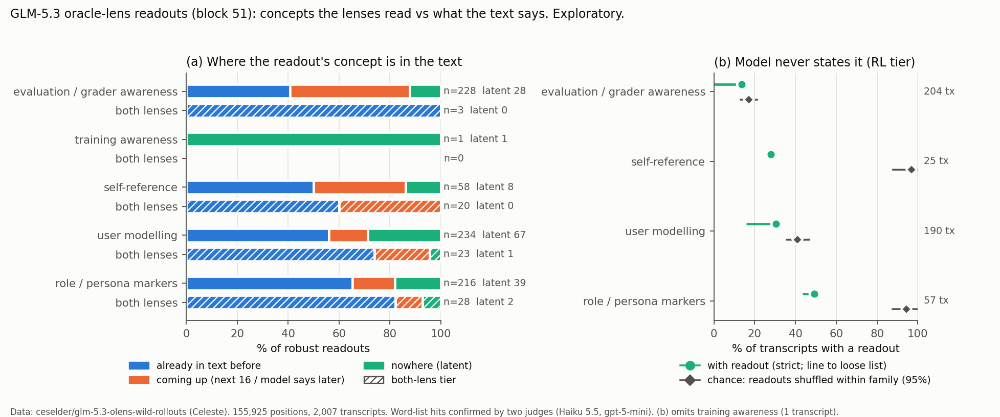

# GLM-5.3 oracle-lens readouts: what the lenses read vs what the model says (exploratory)

**Data: Celeste's `ceselder/glm-5.3-olens-wild-rollouts`** (Hugging Face, revision `4254721c`, built 2026-10-23).
GLM-5.3 (754B MoE) transcripts, read at block 51 by two oracle lenses (an SFT lens and an RL lens), with greedy + 4
samples per lens at every read position. Celeste also ran her own scheming / eval-awareness pass on it (files in the
dataset; cross-checked below). Run 2026-10-24, CPU only, no pre-registration: **exploratory**.

**Question (from the owner's brief).** At 9B, trained habits are invisible to self-report. Does a frontier-scale model
show the same gap for awareness? Is evaluation / grader awareness (and training awareness, self-reference, user
modelling, role markers) present in the readouts but never said in the model's own reasoning or answers? Does it go
with outcomes (`passed`, `reward`)?

## Answer

**No say–do gap for evaluation awareness at the size the brief hoped for. GLM-5.3 says its grader awareness out loud.**

- **Under the brief's rule (≥3 of 5 bullets in both lenses), almost nothing is read.**
  - Eval awareness shows up at 14 of 155,925 positions; 3 survive the two judges, in 3 transcripts.
  - The model states it in all 3.
  - Across all five categories: 74 judge-confirmed both-lens readouts, 3 of them unverbalised.
- **The rule is too strict to show absence.** It fires on only 1.5–8.8% of positions where the model writes the
  concept within the next 16 tokens.
- **With the RL lens alone (≥3/5 RL bullets, both judges confirm), eval awareness is read in 204 transcripts.**
  - 200 of them are agent runs (Terminal-Bench `tmax` 111, SWE-smith 89).
  - It is mostly read on the task prompt and tool output, rarely on the model's own tokens.
- **The model itself states grader awareness in most agent runs:**
  - 90% of `tmax` runs and 78% of SWE-smith runs use "hidden tests", "grader", "evaluator", "benchmark" and the like;
  - for example "figure out what the hidden tests expect", "evaluator likely checks recovered_token".
  - Of the 204 transcripts with a readout, 14% never use such a word. Shuffling readouts within family gives 17%
    [13, 21] by chance.
  - With a loose list (test / check / verify), 0% never say it.
- **Only 28 readouts (12%) are latent, and eval is not special.** Latent here means the concept is nowhere in the text
  before, not in the next 16 tokens, and never said by the model. That 12% is no higher than for self-reference (14%),
  role markers (18%) or user modelling (29%, mostly a word-list artefact).
- **Celeste's 76 "latent" eval-awareness positions are mostly said later in the same run.**
  - In 45 of the 59 that pass the RL tier here, the model writes the words itself later.
  - That happens a median ~2,300 tokens after the read position, 67% of the time beyond her 2,048-token window.
  - Only 7 of 76 stay latent over the whole transcript.
- **No link to outcomes.** Pass rates with vs without an eval readout: `tmax` 73.0 vs 72.5%, SWE-smith 55.1 vs 51.1%.
  Within-task pairs come out at chance. `reward` equals `passed` in every agent run.

**Recommendation:** no slide on "unverbalised evaluation awareness at frontier scale". In these agent runs the RL lens
reads grader awareness early, on the task prompt, and the model then says it. That is a lens-timing result (Celeste's),
not our say–do gap. The 9B habit result stays the say–do evidence. Stop this line here unless the owner wants the
optional verbalisation-judge pass (about $3; it can only shrink the 14%).

## Table

RL tier = ≥3 of the 5 RL bullets match the category's word list and both judges confirm. "Latent" = the concept is not
in the text before the position, not in the next 16 tokens, and the model never writes it in the transcript (strict
list). "By chance" = the strict rate when readout presence is shuffled across transcripts within family × thinking
mode (1,000 draws, 95% range). κ = Cohen's kappa between the two judges on the RL hits.

| category | both lenses ≥3/5, judges confirm: positions (transcripts) | of which latent | RL lens ≥3/5, judges confirm: positions (per 1k) | transcripts | concept already in text before / coming up / latent (%) | model never states it, % of transcripts: strict (loose) | same, by chance | judges κ (RL) |
|---|---|---|---|---|---|---|---|---|
| evaluation / grader awareness | 3 (3) | 0 | 228 (1.46) | 204 | 41 / 47 / 12 | 14 (0) | 17 [13, 21] | 0.80 |
| training awareness | 0 (0) | 0 | 1 (0.01) | 1 | 0 / 0 / 100 | — | — | 0.14 |
| self-reference | 20 (9) | 0 | 58 (0.37) | 25 | 50 / 36 / 14 | 28 (28) | 97 [88, 100] | 0.86 |
| user modelling | 23 (21) | 1 | 234 (1.50) | 190 | 56 / 15 / 29 | 30 (16) | 41 [36, 47] | 0.14 |
| role / persona markers | 28 (15) | 2 | 216 (1.39) | 57 | 65 / 17 / 18 | 49 (44) | 94 [88, 100] | 0.49 |



## Findings in more detail

1. **The SFT lens rarely produces these concepts.** Word-list hits with ≥3/5 bullets: eval 360 RL vs 19 SFT; across
   categories 1,014 RL vs 142 SFT. Celeste saw the same (her 76 latent eval positions: 74 RL only, 2 both). The
   cross-lens rule is therefore mostly a rule about the SFT lens.
2. **RL samples are not independent evidence.** All five RL bullets share their first six words at 8.5% of positions,
   against 0.1% for SFT (mean distinct openings 3.6 vs 4.9 of 5). "3 of 5 RL samples agree" is weaker than it looks.
3. **Where eval awareness is read** (RL tier, per 1,000 positions of that role):
   - task prompt (user role) 6.6 (134 positions) and tool output 5.1 (33);
   - the model's own reasoning 0.9 (53), visible answers 0.1 (7), tool calls 0.2 (1).
4. **The latent 28** (listed by `scripts/dump_latent.py eval rl3` after the judge filter):
   - 24 sit on the task prompt or tool output of agent runs, e.g. "be graded by the external evaluator. The evaluator
     likely checks task completion criteria".
   - In 27 of those 28 runs the model talks about tests and checks in looser words.
   - One WildChat case reads "The user is testing me with false premises" where the model only says "this appears to
     be a fabricated premise".
5. **Self-reference and role readouts track the text.** The concept is already in the text or coming up for 86% /
   82% of readouts. Where a readout appears, the model states the concept in 72% / 51% of transcripts, against 3% / 6%
   when readouts are shuffled. The local-echo rate beats a random same-family, same-role context by a wide margin
   (self 47% vs 0%, role 43% vs 0%, user 32% vs 6%). For eval the concept is rarely in the last 400 characters (5% vs
   4%) but often earlier in the prompt (15%) or in the model's earlier text (35%).
6. **Training awareness is essentially absent.** 27 RL word-list hits; both judges confirm 1. They disagree here:
   Haiku says yes to 4%, gpt-5-mini to 33%, κ 0.14.
7. **User modelling's 29% latent is mostly the word list.** 13 of the 67 are system-prompt positions where the lens
   predicts "The user is asking…" and the model's reasoning phrases it differently. The loose list halves the
   transcript-level rate (30 → 16%). Its κ of 0.14 comes with 81% raw agreement: both judges say yes to 85–90% of
   items, so kappa is low.
8. **Behaviour: one cell moved, and it is a lead at most.**
   - SWE-smith runs with an eval readout on the model's own tokens passed 8/26 vs 159/294 without (31 vs 54%, Fisher
     p = 0.025). It holds across length terciles.
   - But the within-task pairs give 2 of 7, `tmax` shows nothing (22/29 vs 209/289, p = 0.83), and this is one of ~80
     behaviour cells.

## Method

- **Data.** 156,127 positions from 2,009 transcripts: 1,200 on-policy WildChat replies, 320 Terminal-Bench (`tmax`)
  runs, 320 SWE-smith runs and 169 RLVR rollouts. Every read position is a punctuation or newline token, at most 80
  per transcript. `passed` / `reward` exist for the 640 agent runs only.
  - One trial name is used by two different `tmax` transcripts (one passed, one failed): both are dropped (160
    positions).
  - 42 positions whose `left_ctx` is not found in the transcript text are dropped.
  - That leaves 155,925 positions and 2,007 transcripts.
- **Categories** (`scripts/lexicon.py`): a strict word list per category decides whether a bullet carries the concept
  and whether the model's own text states it. A loose list (adds e.g. test / check / verify, AI / model, user) gives
  the other end of the verbalisation range. The lists were frozen after looking at term counts
  (`scripts/explore_terms.py`), before the main tables.
- **Tiers.** Per position and category: how many of the 5 RL bullets and of the 5 SFT bullets match.
  - The brief's rule: ≥3 in both lenses.
  - Also reported: ≥3 in RL only, ≥3 in SFT only, any bullet.
- **Judges** (`judge.py`, `persona_affect.common.judges`): Haiku 5.5 and gpt-5-mini answer yes / no to "do most of
  these five guesses express this category (as defined)?" for every lens hit with ≥3/5 matches (1,156 items). A hit
  counts only if both say yes. Overall κ 0.63 (per category in `results/table_judges.csv`).
  - The planned second judge pass ("does the model's own text state this, in any words?") was skipped to save about
    $3 (owner's call). So verbalisation is word-list only, reported strict (loose).
- **Controls** (`scripts/build.py`): each position's token is located in the full transcript and the text is split by
  role. Then:
  - local echo: the concept is in `left_ctx`;
  - input before: system, user or tool text before the token;
  - model before / after: the model's own reasoning, answer or tool calls;
  - future text: the concept is in `next16`.
- **Baselines** (`scripts/analyse.py`):
  - echo and next-16 rates against a random position of the same family and role from another transcript;
  - the transcript-level "never stated" rate against readout presence shuffled within family × thinking mode;
  - a calibration of how often each tier fires just before the model writes the concept (within 16 tokens) vs where
    the concept is nowhere in the transcript.
  - The data has no non-punctuation positions and no no-activation readouts, so a literal random-token or
    no-activation control was not possible.
- **Cross-checks** (`scripts/crosscheck.py`, `scripts/later_words.py`): against Celeste's judged candidates and her
  latent eval-awareness file; the one behaviour cell with a Fisher test and a length split.

## Caveats

- **Observational.** No personas, installed habits or manipulations. Nothing here tests a causal claim.
- **The lenses are out of distribution.** They were trained on web text with continuation targets, so readouts are
  "what comes next"-style. Chat templates, code and terminal output were never in their training data.
- **Word lists decide verbalisation.** Strict lists miss paraphrases, so the strict "never stated" rates are upper
  bounds. Loose lists over-count: the loose eval list matches any mention of tests, which every agent run has. The
  truth lies between them.
- **"Present in a transcript" depends on which ≤80 positions were read.** Transcripts are not read token by token.
- **Context differs from what the model saw.** `tmax` transcripts restore reasoning the model did not see at generation
  time. 86% of SWE-smith transcripts are cut at 16,384 tokens, so positions come only from the first part;
  verbalisation is checked over the full text.
- **Two categories rest on weak judge agreement:** training awareness and user modelling (κ 0.14).
- **No Qwen comparison inside this dataset.** The scale contrast would rest on Celeste's separate observation.
- **Licences.** The dataset is private research material. Agent traces: open-athena (`license: other`, RLVR1
  apache-2.0); prompts from WildChat-1M (ODC-BY). The `tb_cc/` benchmark-canary files were not used.

## Files and reproduction

```
python3 -I olens_glm/scripts/build.py olens_glm/data olens_glm/results      # positions + transcripts (~80 s)
python3 -I olens_glm/scripts/judge_items.py concept                          # judge items
uv run python -m olens_glm.judge concept                                     # two judges (cache in results/)
cd olens_glm && python3 -I scripts/analyse.py results && python3 -I scripts/headline.py results \
  && python3 -I scripts/figure.py results && python3 -I scripts/crosscheck.py results
```

- **Data.** Download into `olens_glm/data/` (git-ignored): `olens_wild_rollouts.parquet` (sha256 `6e42c4ed…`),
  `transcripts.parquet` (`c44efbb4…`), `scheming_candidates.csv`, `latent_eval_awareness.csv`.
- **Tables.** `results/table_main.csv` (every category × tier), `table_by_role.csv`, `table_calibration.csv`,
  `table_baselines.csv`, `table_behaviour.csv`, `table_judges.csv`, `crosscheck.json`, `headline.json`,
  `table_headline.md`.
- **Spend.** $0.163 (judges via OpenRouter: Haiku $0.046, gpt-5-mini $0.117), `olens_glm/ledger.jsonl`, cap $8.
